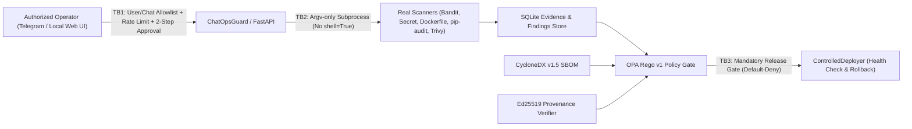

# Threat Model — FORGE (Secure Software Supply Chain & DevSecOps Engineering)

## 1. System Purpose & Trust Boundaries
FORGE mediates code scanning, container policy enforcement, CycloneDX SBOM generation, cryptographic provenance signing, controlled local deployment/rollback, and Telegram ChatOps operations.

## 2. STRIDE Threat Analysis & Controls

| Threat | STRIDE | Attack Scenario | Implemented Mitigation | Verification Test |
|---|---|---|---|---|
| Unauthorized ChatOps access | Spoofing / Elevation | Unknown Telegram user triggers `/deploy` or `/scan` | Default-deny `FORGE_ALLOWED_TELEGRAM_USER_IDS` & `FORGE_ALLOWED_CHAT_IDS` enforced in `ChatOpsGuard` | `test_telegram_chatops_authorization_rate_limit_and_two_step_approval` |
| Command injection via ChatOps | Tampering / Elevation | Attacker sends `/deploy v1; rm -rf /` or arbitrary command | Strict `ALLOWED_COMMANDS` allowlist, regex tag validation, zero `shell=True` anywhere in runtime | `test_telegram_chatops_authorization_rate_limit_and_two_step_approval`, Bandit strict CI gate |
| Artifact tampering post-build | Tampering | Binary/archive modified between build and deployment | Ed25519 DSSE-style provenance envelope bound to SHA-256 digest + commit SHA | `test_ed25519_signing_verification_and_tamper_rejection` |
| Container privilege escalation | Elevation | Image runs as `root`, uses `:latest`, or mounts `/var/run/docker.sock` | OPA Rego v1 (`policies/container_compliance.rego`) + `run_dockerfile_audit` | `opa test policies/`, `test_policy_evaluator_enforces_hardening_and_exceptions` |
| Credential leakage in logs/repo | Information Disclosure | Token printed in `/logs` or committed in source | `redact_sensitive()` on audit logs + `run_secret_scan` redacting matched values | `test_secret_scanner_detects_and_redacts` |
| Scanner error masked as clean | Repudiation / Integrity | Scanner crashes or exits non-zero (`|| true`) | Explicit `ScannerStatus.FAILED` / `UNAVAILABLE`; CI fails on any mandatory gate failure | `src/forge/scanners.py`, `.github/workflows/ci.yml` |

## 3. Residual Risks & Boundaries
- Local Ed25519 signing keys provide artifact integrity within the lab trust root; production deployments should migrate to keyless Sigstore/Cosign OIDC or hardware-backed KMS signing.
- Offline environments cannot query live NVD/OSV databases for `pip-audit`/`trivy`; FORGE explicitly marks them `UNAVAILABLE` rather than `PASS`.
